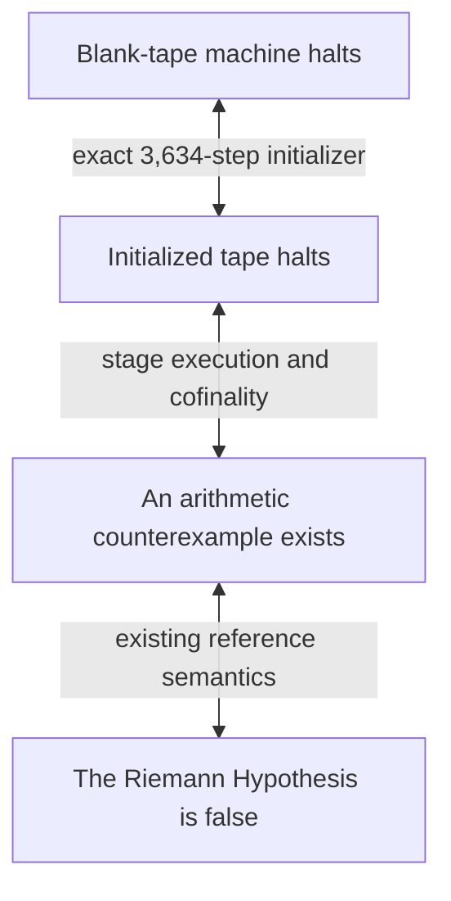

# Riemann95 proof guide

Start with [`../../Semantics/Riemann95.lean`](../../Semantics/Riemann95.lean).
Its end-to-end theorem has no extra hypotheses:

```lean
theorem halts_candidate_iff_not_riemannHypothesis :
    Halts ConjectureMachines.Riemann95.candidate ↔ ¬ RiemannHypothesis
```

`Halts` means execution from state 0 on the blank tape. The proof covers the
initializer and unbounded execution, including the first stage.



The short proof in [`../../Riemann95.lean`](../../Riemann95.lean) exposes two
named steps: `halts_candidate_iff_counterexample` connects the actual blank run
to the arithmetic criterion; `candidate_equivalent` connects that criterion to
`Riemann104`. The semantics module composes with the existing Riemann theorem.

The construction retains the stage counter in `x` after `FOLD` and permutes the
physical register banks. This changes the register program and its tape
implementation, so the proof establishes both program correctness and physical
execution rather than a quotient of the 104-state transition table.

The 52 new Lean modules include five shared reference-support modules. Related
decoder, control, bootstrap, return, and trace lemmas are grouped together.
Read the layers in this order:

| Layer | Entry points | Purpose |
| --- | --- | --- |
| Literal machine | [`../../Riemann95Definition.lean`](../../Riemann95Definition.lean) | Defines all 190 transition cells and the initial root configuration. |
| Blank initialization | [`Bootstrap95.lean`](Bootstrap95.lean) | Checks all 3,634 steps, identifies the entire tape, and transfers halting to the initialized configuration. |
| Reference program | [`ReferenceLogical95.lean`](ReferenceLogical95.lean), [`ReferenceLogicalSemantics95.lean`](ReferenceLogicalSemantics95.lean), [`ReferencePermutation95.lean`](ReferencePermutation95.lean), [`ReferenceBridge95.lean`](ReferenceBridge95.lean) | Relates the reordered program and register permutation to the original 104-state semantics, including the stopped pre-width computation. |
| Decoder and control | [`Parser95.lean`](Parser95.lean), [`ControlStep95.lean`](ControlStep95.lean) | Proves recursive decoding, control flow labels, and closure of encoded configurations. |
| Tape operations | [`Auxiliary95Contracts.lean`](Auxiliary95Contracts.lean), [`Return95.lean`](Return95.lean), [`Terminal95.lean`](Terminal95.lean) | Proves arithmetic, returns, jumps, and the halting transition, preserving the required tape frames. |
| Physical execution | [`PhysicalTrace95.lean`](PhysicalTrace95.lean), [`PrecreditTrace95.lean`](PrecreditTrace95.lean) | Lifts program steps to the actual machine and handles growing padding and width changes. |
| Complete stages and halting | [`Stage95.lean`](Stage95.lean), [`Witness95.lean`](Witness95.lean) | Proves outcomes for every stage and directly derives the unconditional counterexample criterion by cofinality. |

`Witness95` uses the actual `physical_stage_outcomes` theorem directly. There is
no remaining stage-simulation premise for a caller to supply. Its
`counterexample_iff_positive_stage` lemma discharges the safe initial test when
matching the reference's stage numbering.

Shared reference facts live in [`../Riemann/`](../Riemann/).
`ControlWords`, `ControlSoundness`, and `WordGuard` certify the reference control
invariants; `FiniteStage` and `ReferenceStageRange` connect safe finite starting
stages to the original blank run. These facts do not depend on another reduced
machine.

All new proof modules use the pinned toolchain and existing Lean limits. The
three public results are checked against the independent table specification in
`Riemann95Challenge.lean` by `comparator/riemann_95.json` and `comparator/all.json`.
